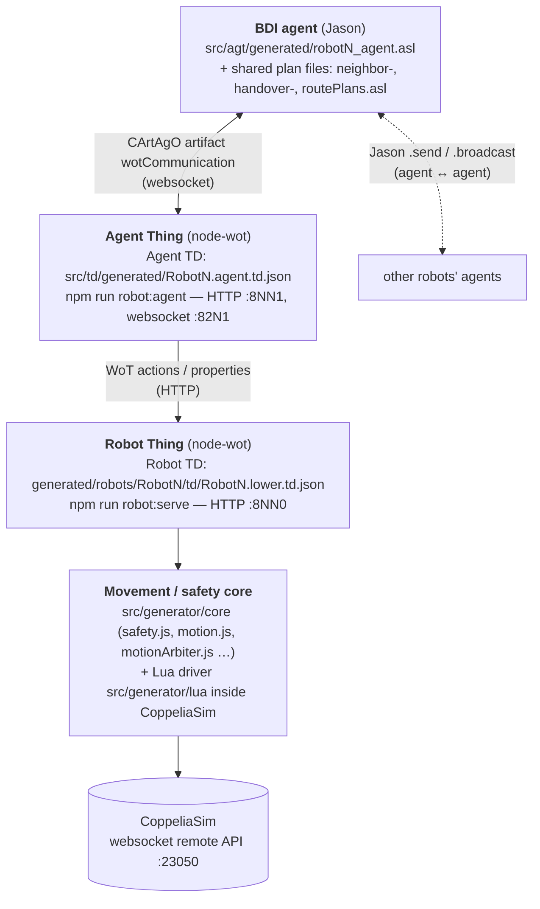

# WoMAT — Web of Multi-Agent Things for robot cells

WoMAT turns a robot description (URDF) into a complete, self-describing unit:
a **BDI agent** (Jason/JaCaMo) that reasons, an **Agent Thing** that exposes the agent
over the Web of Things, a **Robot Thing** that exposes the simulated arm, and a
**movement/safety core** that decides whether any commanded motion may run. Several
units are then placed in one shared CoppeliaSim cell. There, the agents work out for
themselves which arms are neighbours, compute the space they share, find a route for a
cube from support A to support B by distributed consensus, and pass the cube along with
physical handovers.

No central planner is involved. Every robot only knows its own workspace and what its
neighbours tell it.

---

## Contents

1. [Architecture: one robot unit](#1-architecture-one-robot-unit)
2. [Prerequisites](#2-prerequisites)
3. [Part A — Generate and run a single robot](#3-part-a--generate-and-run-a-single-robot)
4. [Part B — Build a shared cell from several robots](#4-part-b--build-a-shared-cell-from-several-robots)
5. [Part C — Run the cell and deliver the cube](#5-part-c--run-the-cell-and-deliver-the-cube)
6. [Trying the agents without a simulator](#6-trying-the-agents-without-a-simulator)
7. [What happens at startup](#7-what-happens-at-startup)
8. [Repository layout](#8-repository-layout)
9. [Further documentation](#9-further-documentation)
10. [Troubleshooting](#10-troubleshooting)

---

## 1. Architecture: one robot unit

Every robot is the same four-layer stack, generated from its URDF and a few parameters:



| Layer | What it is | Responsibility |
| --- | --- | --- |
| **Agent** | `robotN_agent.asl`, run by JaCaMo | Beliefs, goals and plans: neighbour discovery, interaction spaces, task-site detection, route consensus, handover protocol. Talks to other agents with native Jason messages. |
| **Agent Thing / Agent TD** | `agentThingServer.js`, `RobotN.agent.td.json` | The agent's WoT face. Translates agent requests (`wotAchieve(...)`) into Robot Thing calls and turns results back into beliefs. Also exposes agent goals such as `deliverCube` as HTTP actions. |
| **Robot Thing / Robot TD** | `lowerThingServer.js`, `RobotN.lower.td.json` | The arm's WoT face: `moveTocartesianPosition`, `moveTojointPosition`, gripper, workspace and handover actions, joint and Cartesian state. |
| **Safety core** | `src/generator/core`, `src/generator/lua` | Workspace admission, swept collision preflight against walls, supports and other arms, region/zone locking between arms, smooth trajectory execution, watchdog. Every motion passes through it, whoever asked for it. |

Each robot gets its own block of ports, written to its `manifest.json` and to `config.json`:
Robot1 = `8110` (Robot Thing) / `8111` (Agent Thing) / `8211` (agent websocket),
Robot2 = `8120/8121/8221`, and so on.

---

## 2. Prerequisites

| Tool | Notes |
| --- | --- |
| **Node.js** ≥ 18 and npm | `npm install` in the repository root. |
| **Java 22** | JaCaMo 1.2 runs through the bundled Gradle wrapper (`./gradlew`, toolchain 22). No global Gradle is needed. |
| **CoppeliaSim 4.10** (Edu) | The **websocket remote API on port 23050** must be enabled. The **URDF plugin** (`simURDF`) is needed for model import. |
| **RobWoT assets** | The URDFs come from `external/RobWoT/Assets/URDFs/` (UR3/UR10, Dobot CR3/CR5/CR10, …). |
| `lua` (optional) | Only for the offline driver tests in `npm test`. |

```bash
npm install
npm test          # offline regression suite: no simulator, no MAS
```

> On laptops with hybrid graphics, run CoppeliaSim on the discrete GPU. Rendering
> through Mesa on the integrated GPU has crashed the simulator after roughly ten minutes.

---

## 3. Part A — Generate and run a single robot

All commands run from the repository root. Robot1 (a UR10) is used as the example.

### A1. Generate the unit (no simulator needed)

```bash
npm run generate:robot -- \
  --urdf external/RobWoT/Assets/URDFs/ur_description/urdf/ur10_robot.urdf \
  --name Robot1 \
  --platform fixed \
  --thing-port 8110 --agent-port 8111 --websocket-port 8211 \
  --home-position 0,0,0.30 \
  --horizontal-position 0.30,0,0.35 \
  --grip-position 0.9,-0.18,0.19 \
  --carry-position 0.40,0.20,0.35 \
  --home-joints 0,0,0,0,0,0
```

This writes the whole unit:

| Artefact | Path |
| --- | --- |
| Manifest (single source of truth for this robot) | `generated/robots/Robot1/manifest.json` |
| BDI agent | `src/agt/generated/robot1_agent.asl` |
| Agent Thing + Agent TD | `src/WoT/generated/Robot1_agent_thing.ts`, `src/td/generated/Robot1.agent.td.json` |
| Robot Thing source | `src/WoT/generated/Robot1_lower_thing.ts` |
| Single-robot JaCaMo app | `generated/robots/Robot1/Robot1.jcm` |
| Port entry | `config.json` (skip with `--skip-config-update`) |
| Per-robot instructions | `generated/robots/Robot1/README.md` |

Run `npm run generate:robot` with no arguments to see every option: gripper
orientation and offsets, mobile platforms (`--platform omnidirectional`), joint
overrides, and more. A worked example for a differently built arm (Dobot CR5, with
gripper rotation and jaw offset) is in
[docs/three_robot_interaction_chain.md](docs/three_robot_interaction_chain.md#1-generate-robot3).
To fit another gripper, see [docs/fitting_a_different_gripper.md](docs/fitting_a_different_gripper.md).

### A2. Check the paths (still no simulator)

```bash
npm run robot:pipeline -- --manifest generated/robots/Robot1/manifest.json --dry-run
```

### A3. Sample the workspace and generate the Robot TD (CoppeliaSim running)

Start CoppeliaSim, then:

```bash
npm run robot:pipeline -- --manifest generated/robots/Robot1/manifest.json --full-pipeline
```

`--full-pipeline` is `--generate-model` followed by `--generate-td`. Both steps can be
run separately. The pipeline:

1. imports the URDF, attaches the gripper and saves `model/Robot1.ttm`;
2. **samples the reachable workspace** by random joint configurations, with collision
   checking against the robot itself and its wall, and stores
   `info/Robot1_data_point.csv`, `info/Robot1_info.json` and `info/Robot1_shape.stl`;
3. builds a workspace scene `scene/Robot1_workspace.ttt` (point cloud, convex hull,
   collision regions);
4. writes the **Robot TD** `td/Robot1.lower.td.json`.

The sample count is set by `pipeline.workspaceRandomSteps` in the manifest. The default
of `8000` is enough for a quick test; the evaluated cells use `40000`.

### A4. Run the unit

Use three terminals:

```bash
# 1 — Robot Thing + safety core (loads the workspace scene into CoppeliaSim)
npm run robot:serve -- --manifest generated/robots/Robot1/manifest.json

# 2 — Agent Thing (the bridge the JaCaMo artifact connects to)
npm run robot:agent -- --manifest generated/robots/Robot1/manifest.json

# 3 — the BDI agent
./gradlew -Pjcm=generated/robots/Robot1/Robot1.jcm
```

Talk to each layer directly to see how the stack fits together:

```bash
# Robot TD
curl http://localhost:8110/coppeliasim_virtualrobot_Robot1

# A motion through the safety core (refused with path_collision_detected if it would hit the wall)
curl -X POST http://localhost:8110/coppeliasim_virtualrobot_robot1/actions/moveTocartesianPosition \
  -H 'Content-Type: application/json' -d '{"x":0.1,"y":0.1,"z":0.4}'

# Agent TD
curl http://localhost:8111/robot1_agent
```

Motion speed, step counts, collision checking and preflight are configured under
`runtime` in the manifest. The generated per-robot README lists those keys.

---

## 4. Part B — Build a shared cell from several robots

### B1. Generate and sample every robot

Repeat Part A, steps **A1 and A3**, for each robot. Give each robot its own name and
port block, for example:

| Robot | URDF | Ports (thing / agent / ws) |
| --- | --- | --- |
| Robot1 | `ur_description/urdf/ur10_robot.urdf` | 8110 / 8111 / 8211 |
| Robot2 | `ur_description/urdf/ur3_robot.urdf` | 8120 / 8121 / 8221 |
| Robot3 | `cr_description/urdf/cr5_robot.urdf` | 8130 / 8131 / 8231 |
| Robot4 | `cr_description/urdf/cr3_robot.urdf` | 8140 / 8141 / 8241 |
| Robot5 | `cr_description/urdf/cr10_robot.urdf` | 8150 / 8151 / 8251 |

Each robot is sampled **once, in its own frame**. Placing it in a cell later does not
require resampling.

### B2. Assemble the cell

A three-robot example (the positions are illustrative; adjust them to your layout):

```bash
npm run robot:pipeline -- \
  --manifests generated/robots/Robot1/manifest.json,generated/robots/Robot2/manifest.json,generated/robots/Robot3/manifest.json \
  --generate-shared-cell \
  --offsets "0,0;1.25,0.20;2.10,0.20" \
  --orientations "0,0,0;0,0,180;0,-90,180" \
  --sites "Robot1_grip_support@0.9,0,0.08,Robot1_grip_cube; Robot3_grip_support_b@2.6,0.2,0.08"
```

| Option | Meaning |
| --- | --- |
| `--offsets "x,y;…"` | Base position of each robot in the cell frame, in metres, in the order of `--manifests`. |
| `--orientations "r,p,y;…"` | Base orientation in degrees. Some Dobot URDFs need a `-90` pitch to stand upright; the last value is the yaw on the floor. (`--rotations "yaw;…"` is the yaw-only form.) |
| `--wall-offsets`, `--wall-yaws` | Move or turn each robot's wall panel. |
| `--sites "alias@x,y,z[,yawDeg][,payload];…"` | Cube supports in the **cell** frame. The site that carries a payload is support **A**, where the cube starts. Every other site is an empty destination **B**. Which arm serves which site is never declared; the agents discover it. |
| `--interaction-pairs "Robot1:Robot2;…"` | Optional. Pre-declares pairs. Without it, the agents discover neighbours themselves. |
| `--resample "Robot3"` | Resample one robot in place, for example after a wall moved into its workspace. |
| `--static-chain` | Also emit the old configured handover chain, as a baseline to compare the discovered route against. |

The command produces:

```text
generated/robots/Robot1_Robot2_Robot3.shared.json    # cell descriptor: placements, walls, sites, pairs
generated/robots/Robot1_Robot2_Robot3_shared.ttt     # the shared CoppeliaSim scene
generated/robots/Robot1_Robot2_Robot3.jcm            # one JaCaMo app with all agents
```

It also records each robot's placement in its own manifest (`sharedEnvironment`), so
the runtime needs no offsets on the command line.

**Choosing a layout.** Two arms can only hand over if their workspaces overlap at
handover height (`handoverHeightRange`, default 0.30–0.65 m). If a pair reports
`no_geometric_overlap` or `voxel_intersection_empty`, move the later robot toward its
partner in steps of about 5 cm and regenerate. The more distant robot is the one to
move, so that pairs that already work stay calibrated. A layout with a loop, such as
a diamond 1–2–4 / 1–2–3–4, gives the route search a real choice between routes.

The existing five-robot cell (`Robot1 … Robot5`) was assembled with the values stored
in its descriptor:

```bash
npm run robot:pipeline -- \
  --manifests generated/robots/Robot1/manifest.json,generated/robots/Robot2/manifest.json,generated/robots/Robot3/manifest.json,generated/robots/Robot4/manifest.json,generated/robots/Robot5/manifest.json \
  --generate-shared-cell \
  --offsets "0,0;1.39,0.19;2.19,1.14;2.12,-0.24;3.48,0.28" \
  --orientations "0,0,-15;0,0,50;-90,-155,90;-90,35,90;-90,20,90" \
  --wall-offsets "0,0;0,0;-0.42876,-0.25726;-0.2,-0.2;-0.3,-0.3" \
  --sites "Robot1_grip_support@0.55,0.55,0.08,0,Robot1_grip_cube; Robot5_grip_support_b@4.33,0.28,0.08"
```

---

## 5. Part C — Run the cell and deliver the cube

Start CoppeliaSim and then open one terminal per process:

```bash
# 1 — the cell host: loads the shared scene, spawns every arm, starts one safety core per arm
npm run robot:serve -- \
  --manifests generated/robots/Robot1/manifest.json,generated/robots/Robot2/manifest.json,generated/robots/Robot3/manifest.json

# 2…N+1 — one Agent Thing per robot
npm run robot:agent -- --manifest generated/robots/Robot1/manifest.json
npm run robot:agent -- --manifest generated/robots/Robot2/manifest.json
npm run robot:agent -- --manifest generated/robots/Robot3/manifest.json

# last — all agents in one MAS
./gradlew -Pjcm=generated/robots/Robot1_Robot2_Robot3.jcm
```

Options for `robot:serve` in a cell:

| Flag | Effect |
| --- | --- |
| *(none)* | Region arbitration: an arm waits only for arms whose paths claim the same shared space. |
| `--exclusive-motion` | Only one arm moves at a time. This is the serialised baseline for comparisons. |
| `--isolated-cores` | One OS process per safety core. The cores reach each other over their Robot Things. |
| `--per-robot-grip` | Gives each robot its own cube instead of the cell's shared one. |

Wait until the agent holding the cube prints `Route settled: hand to … for a total of … m`,
then start the transfer. You can do this from the Jason console (`!deliverCube` to the
source agent) or over HTTP:

```bash
curl -X POST http://localhost:8111/robot1_agent/actions/deliverCube
```

The cube is picked at A, handed from arm to arm along the agreed route, and placed on B.
Each arm reads only its own next hop. To see that the route is discovered and not
configured, move the cube or support in the scene and restart the agents **without
regenerating anything**. A different arm will claim A, and the route will re-form.

> Agent `.print` output appears in the JaCaMo MAS console window, not in Gradle's
> stdout. The Agent Thing terminals show each agent's calls to its robot.

Stop everything and free ports that are still in use with:

```bash
npm run robot:cleanup                 # also closes CoppeliaSim
npm run robot:cleanup -- --keep-sim   # leaves CoppeliaSim running
npm run robot:cleanup -- --dry-run    # only reports what it would stop
```

---

## 6. Trying the agents without a simulator

The whole coordination layer (neighbours, route consensus, rerouting) can be run
against made-up sites and costs, with no CoppeliaSim and no Robot Things. This is the
fastest way to see the protocol work:

```bash
npm run robot:agent -- --manifest generated/robots/Robot1/manifest.json \
  --mock-neighbors "Robot2,Robot3" --mock-costs "Robot2=0.10,Robot3=0.90" \
  --mock-sites "Robot1_grip_support=holding:Robot1_grip_cube,Robot4_grip_support_b=out"
# … one line per robot with its own neighbours, costs and sites …
./gradlew -Pjcm=generated/robots/Robot1_Robot2_Robot3_Robot4.jcm
```

Site states are `out` (seen but not reachable), `empty`, or `holding:<cube>`.
A complete four-robot diamond, with the expected numbers worked out, is in
[docs/bellman_consensus_routing_plan.md](docs/bellman_consensus_routing_plan.md#how-to-test-it).

---

## 7. What happens at startup

Every generated agent runs the same `!init` sequence. Nothing in it names another robot:

1. **`!discoverNeighbors`** — reach-sphere test against every arm in the cell
   (`neighborPlans.asl`).
2. **`!shareInteractionSpaces`** — for each neighbour, the pair's shared workspace is
   voxelised. The alphabetically first robot of the pair computes it, so no negotiation
   is needed. Results are cached in `generated/robots/interactions/<A>__<B>/`.
3. **`!detectTaskSites`** — reads the supports from the scene and classifies each one
   as reachable and/or occupied. The arm that reaches the loaded support believes it is
   at A (`hasSource`); the arm that reaches the empty one believes it is at B (`hasSink`).
4. **`!reportHandoverCosts`** — the arm at A prices each handover to a neighbour.
5. **`!discoverRoute`** — distributed route consensus: a `findRoute` flood goes out,
   costs are accumulated one leg per arm on the way back, and every arm stores its own
   `nextHop` (`routePlans.asl`).

`!deliverCube` then executes the route with the giver/receiver handover protocol
(`handoverPlans.asl`). If a hop fails at execution time, the arm holding the cube
strikes that hop and switches to the next-cheapest route it already knows, without
sending any messages.

---

## 8. Repository layout

```text
src/
  agt/                      Jason plan files
    neighborPlans.asl       neighbour discovery, pair ownership, shared spaces
    routePlans.asl          task sites, edge costs, route consensus, rerouting
    handoverPlans.asl       giver/receiver handover protocol, placement
    wotPlans.asl            wotAchieve / WoT plumbing
    generated/              one robotN_agent.asl per robot
  env/wotCommunication/     CArtAgO artifact: agent <-> Agent Thing (websocket)
  generator/
    generateRobot.js        Part A1: generate a unit
    robwotBridge.js         robot:pipeline: model, workspace sampling, TD, shared cell
    lowerThingServer.js     robot:serve: Robot Thing(s) + cell host
    agentThingServer.js     robot:agent: Agent Thing, mock mode
    interactionSpace.js     voxel intersection, rendezvous candidates and ranking
    routeSearch.js          executable model of the route consensus (tests)
    core/                   safety core: safety, motion, arbiter, handover, cell host
    lua/                    driver running inside CoppeliaSim
  td/generated/             Agent TDs
  WoT/generated/            generated Thing sources
  eval/                     experiments E1–E13 (npm run eval:…)
generated/robots/           manifests, models, workspaces, Robot TDs, cells, interaction spaces
docs/                       design notes and experiment guides
external/RobWoT/            URDF assets
```

---

## 9. Further documentation

**How specific mechanisms work**

| Topic | Document |
| --- | --- |
| Distributed route consensus between the agents: formulas, protocol, properties | [Distributed_Route_Consensus_Robot_Agents.docx](Distributed_Route_Consensus_Robot_Agents.docx), [docs/bellman_consensus_routing_plan.md](docs/bellman_consensus_routing_plan.md) |
| Automatic voxel size for intersecting workspaces | [Automatic_Voxel_Size_Estimation_Robot_Workspaces.docx](Automatic_Voxel_Size_Estimation_Robot_Workspaces.docx), [docs/voxel_grid_size_approximation.md](docs/voxel_grid_size_approximation.md) |
| Choosing the handover point inside a shared space | [documents/interaction_region_center_approximation.md](documents/interaction_region_center_approximation.md) |
| Safety pipeline and motion concept (admission, preflight, locking) | [docs/robot_safety_and_movement_concept.md](docs/robot_safety_and_movement_concept.md) |
| Walls and the initial space lock | [docs/wall_placement_and_space_lock.md](docs/wall_placement_and_space_lock.md) |
| End-to-end three-robot walkthrough, handover zones | [docs/three_robot_interaction_chain.md](docs/three_robot_interaction_chain.md) |
| Testing the interaction-space agent plans | [docs/interaction_space_agent_testing.md](docs/interaction_space_agent_testing.md) |
| Fitting a different gripper | [docs/fitting_a_different_gripper.md](docs/fitting_a_different_gripper.md) |
| Per-agent safety cores (process isolation) | [docs/agentic_per_agent_cores_plan.md](docs/agentic_per_agent_cores_plan.md) |
| Phases 1–6 report | [docs/womat_robwot_phase_1_6_report.md](docs/womat_robwot_phase_1_6_report.md) |

**Experiments**

| Experiment | Guide |
| --- | --- |
| E10 — exclusive vs. region arbitration | [docs/e10_arbitration.md](docs/e10_arbitration.md) |
| E11 — scaling of route discovery | [docs/e11_scaling.md](docs/e11_scaling.md) |
| E12 — principal five-robot delivery | [docs/e12_principal.md](docs/e12_principal.md) |
| E13 — rerouting around a failed arm | [docs/e13_rerouting.md](docs/e13_rerouting.md) |
| E15 — Dobot cell | [docs/e15_dobot_cell.md](docs/e15_dobot_cell.md) |

---

## 10. Troubleshooting

| Symptom | Cause / fix |
| --- | --- |
| `cannot connect to localhost:23050` | CoppeliaSim is not running, or its websocket remote API is disabled. |
| `simURDF.import` missing | Install or enable the CoppeliaSim URDF plugin and restart CoppeliaSim. |
| A pair reports `no_geometric_overlap` | The arms are too far apart. Move one toward the other and regenerate the cell (Part B2). |
| `Route settled` never appears | Check the MAS console. `noRoute` from every branch means no arm can reach B, or a link has no rendezvous at handover height. |
| An agent reports `layerUnreachable` / announces it cannot serve | That robot's Agent Thing or Robot Thing is not running. The others route around it. |
| `EADDRINUSE` on start | A previous run is still holding the port: `npm run robot:cleanup -- --keep-sim`. |
| Lua driver change has no effect | The driver is loaded when `robot:serve` starts. Restart the cell host. |
