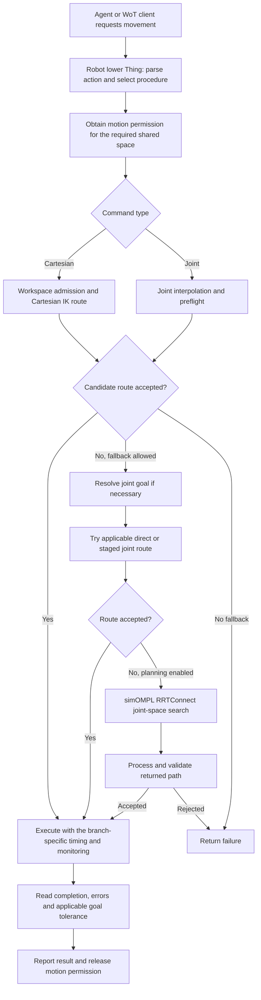

# Robot safety and movement concept

This document describes the implemented WoMAT robot movement stack as inspected on 2026-09-11. It applies to robots generated for this project through their manifest, Thing Description (TD), simulator model, and driver. Robot-specific kinematics and runtime options select the applicable branches; there is no single algorithm that every command always runs through.

The scope is ordinary Cartesian and joint movement, picking and placing, path preparation, preflight validation, execution, and runtime monitoring. Handover protocols, sessions, approach geometry, and transfer procedures are intentionally outside this document. The arbiter is described only by its global responsibility in the split-core architecture.

Implementation references below are relative to this file. Older architecture plans and comments can describe earlier behavior; the function bodies referenced here are the basis of this account. This is an implementation explanation, not a claim of certified physical robot safety.

## 1. The overall pipeline

A task-level agent requests an action. The robot's lower Thing chooses a movement procedure, checks whether it may start, prepares or validates a route, executes it in CoppeliaSim, and reports success or a reason for failure. Reachability, path geometry, trajectory timing, collision checks, and coordination answer different questions.



This diagram shows the ordinary command wrapper. A known route using the reserved-path executor has its own preparation/permission/preflight order, described in section 7. Picking and placing also have dedicated procedures instead of going through the general Cartesian sequence unchanged.

The layers are:

| Layer | Question it answers |
| --- | --- |
| Task-level agent and AgentThing | Which action should this robot perform? |
| Workspace admission | Is the requested point sufficiently close to this robot's sampled reachable positions? |
| IK, inverse kinematics | Which joint configuration puts the tool at the required position or pose? |
| Route construction and planning | Which sequence of joint configurations connects the current posture to the goal? |
| Trajectory timing | How far should the robot advance at each simulation step? |
| Preflight | Do the sampled proposed configurations violate the applicable geometry checks? |
| Runtime monitoring | Does the executing robot violate the enabled checks or reservation? |
| Motion arbiter | Which robots may use the contested shared space at the same time? |

## 2. Robot-independent inputs, units, and frames

Each robot supplies a generated manifest, TD, Lua driver, scene/model, and workspace CSV. The manifest selects limits, tolerances, gripper configuration, placement, and optional strategies. The TD determines the ordered list of commandable joints. The runtime builds an arm chain from the generated driver; it does not assume that every robot has six controllable axes.

TD-facing joint values are degrees. `jointPayloadToRadians` converts them to radians for simulator and planner operations. Cartesian positions and geometric tolerances are metres. Cartesian TD requests use the robot-local frame in which its workspace was generated. Scene collision geometry and cross-robot spatial geometry use world coordinates.

The mapping in `01-base-frame.lua` is:

```text
p_world = translation + R * p_local
p_local = transpose(R) * (p_world - translation)
```

`R` includes the configured roll, pitch, and yaw. A direction vector is rotated without translation. World-up approaches are converted into the robot-local frame, so a rotated mounting does not make a top-down pick descend along the wrong axis. The main position mapping uses the configured base pose; manually moving a base requires keeping the configuration and derived geometry consistent. One current exception is the coarse target hint used by `thing.js` for motion claims: its `worldTargetOf` helper applies translation and yaw only. That hint is not the full roll/pitch/yaw transform used to drive the tool in Lua.

The tool control point (TCP) is the point the gripper should put at a commanded target. `07-tool-frame.lua` establishes the tool point and the IK tip/frame alignment; the flange and TCP can be separated by the tool length. General movement uses the configured tool-control setup, while the top-down workspace probe explicitly adds `toolLengthEstimate` along world up to account for the sampled tip/flange geometry.

Locked joints are removed from the controllable chain and made passive in the relevant IK environments. Merely removing an axis from a command would not prevent an IK solver from using it. `lockToolOrientation` selects full-pose constraints for general simple motion; otherwise that motion uses position-only IK and leaves wrist orientation free. This is a manifest choice, not a rule based solely on a robot's name.

## 3. What happens after a movement request

### 3.1 Ordinary Cartesian movement in simple smooth mode

`thing.js` selects `simpleSmoothCartesianMove` when `runtime.simpleSmoothMotion === true`. For an ordinary position request, the order is:

1. Refresh robot-local obstacle boxes used by workspace admission.
2. Try the straight Cartesian route first. This remains the first choice in this mode even if `preferJointTrajectoryForCartesian` or `preferOmplForCartesian` is set.
3. `guardSimpleCartesianPose` samples the line, applies workspace path admission, and runs a bounded IK/body sweep through `womatSweepCartesianPath`.
4. If accepted, `womatStartSimpleCartesian` starts `sim.moveToPose`. Its callback applies IK to each target pose and invokes the enabled runtime watchdog.
5. Wait for the coroutine to finish, check its stored error, and compare the measured Cartesian endpoint with the target.
6. On an eligible failure before execution, try `cartesianPlannerFallback`. A collision error during execution or a timeout is returned directly rather than automatically starting another motion.

`returnHomeBetweenHandovers` does not affect this fallback: it only selects the handover route of the agent (receive, return home, give) and leaves every stage of the movement core enabled. With reserved-path execution, fallback additionally requires a `safeToReplan` result, indicating that the rejected proposal has not moved the arm.

The general simple IK environment uses damped least squares, damping `0.02`, up to `200` iterations, and element precision `{0.001, 0.01}`. IK is seeded continuously from the preceding posture. The same `womatApplyCartesianTarget` entry point is used by the simple sweep and route preparation, reducing differences between what is checked and what is driven.

### 3.2 Ordinary joint movement

In simple mode, `simpleSmoothJointMove` reads the current joints, constructs a straight joint interpolation, and preflights it. If accepted, it starts `sim.moveToConfig` through `womatStartSimpleJoint`. After execution it checks the maximum absolute joint error against `pathTrackingToleranceDeg`.

If the straight interpolation is blocked, `planAndFollow` tries an optional base-joint-first route and then OMPL if planning is enabled. A blocked line between two postures does not by itself mean the goal posture is unreachable.

The base-joint-first route changes joint 1 to its target while holding all other joints at their starting values, then changes the remaining joints. It is attempted only when `preferBaseJointFirst` is enabled and the first joint's change exceeds `baseJointFirstMinDeltaDeg`. Its sampled configurations are swept before playback. This heuristic runs before the `enablePathPlanning` check in `planAndFollow`, so disabling OMPL does not disable this separately enabled staged route.

When a reserved executor is supplied, simple joint movement instead creates a timed `homeTrajectory` and submits the complete route to that executor.

### 3.3 Cartesian fallback: IK first, then a route to the IK goal

`cartesianPlannerFallback` first requires `enablePathPlanning`, then calls `womatFindGoalConfig`:

1. Save the current joint positions, controller targets, and target dummy pose.
2. Set the robot-local target in world coordinates and create a scratch position-only IK environment.
3. Try a solve seeded from the current posture.
4. If no accepted solution is found, use randomized `simIK.findConfig` search with `womatGoalConfigValid` as the validation callback.
5. Restore the saved scene state and return the goal joint configuration, or a failure.

This search finds a posture. It does not find a route to that posture.

The next stage depends on the execution mode:

| Branch | Route order after finding the goal configuration |
| --- | --- |
| Simple smooth Cartesian fallback without a reserved executor | `prepareJointRoute`: densely check direct joint interpolation, then call OMPL if blocked and allowed; execute the returned joint route. |
| Simple smooth Cartesian fallback with a reserved executor | `prepareJointRoute` prepares a timed direct joint proposal; the reserved executor performs its dense preflight. An eligible refusal returns to the outer fallback/permission logic. |
| Non-simple Cartesian fallback, normal preference | `tryDirectJointTrajectory`, then `planAndFollow` if the direct route fails. |
| Non-simple Cartesian fallback with `preferOmplForCartesian` | Skip `tryDirectJointTrajectory`, enter `planAndFollow`; an enabled base-joint-first heuristic can still precede OMPL. |

Cartesian fallback permits a different redundant joint solution at completion and judges the measured Cartesian endpoint. Explicit joint actions require their joint goal where that execution branch implements the corresponding check.

### 3.4 The non-simple compatibility path

If `simpleSmoothMotion` is false, `smoothCartesianMove` and `smoothJointMove` are selected. These remain active code paths, including for manifests that omit the simple-mode flag.

For Cartesian movement, `preferJointTrajectoryForCartesian` defaults to true and sends the action directly into Cartesian fallback. `preferOmplForCartesian` and `preferBaseJointFirst` also select that route. If these preferences are disabled, the code checks the straight tool line, preflights its IK/body path, and executes Cartesian increments with point/body checks. A blocked increment can trigger rollback to the previous point and planner fallback.

For joint movement, `smoothJointMove` preflights the interpolation and replays its sampled configurations. A failed sweep enters `planAndFollow`. The preflight can be capped more coarsely than playback, even though both describe the same interpolated geometry.

### 3.5 Picking and placing

When the pickup approach mode is active and top-down picking is enabled, simple Cartesian movement selects `topDownPick`. The same function distinguishes picking from placing using whether a held object exists.

For a pick, it constructs the grasp and hover points, checks sampled workspace reachability, solves a top-down hover posture, and solves a sequence of vertical descent postures from it before moving. The dedicated IK task constrains position and tool-axis alignment while allowing roll about that axis. It tries the current posture as a seed, then randomized candidate search if necessary, prefers a nearby valid configuration, and checks actual position and axis error. Search candidates can use contact-only checks; selected candidates also pass the applicable clearance check.

The robot reaches the hover by preflighted joint interpolation and smooth joint execution. If that approach is obstructed, it tries an OMPL route. It then replays the prepared descent and verifies the final tool position. Gripper close/attach is a separate action.

For a place, the target is a release point above the support and there is no descent leg. If enabled, face search tries other supported points on the surface when the requested centre cannot be served, using a short planning budget followed by the full budget if needed. The robot moves to the accepted release posture; opening the gripper is separate. The reported endpoint is checked against the selected release point, including any relocation.

## 4. Where simOMPL comes in

**OMPL** is the Open Motion Planning Library. **simOMPL** is CoppeliaSim's plugin interface to it. WoMAT uses it to find joint-space detours when an applicable simpler route has failed, or when a branch explicitly prefers planning. It returns geometric configurations; execution timing and runtime supervision remain separate responsibilities. [CoppeliaSim planning overview](https://manual.coppeliarobotics.com/en/pathAndMotionPlanningModules.htm)

The selected algorithm is **RRTConnect**. It grows one rapidly exploring random tree from the start and another from the goal and attempts to connect them through valid motions. Its purpose here is to find a usable connection, rather than optimize cycle time or guarantee the shortest path. [OMPL RRTConnect reference](https://ompl.kavrakilab.org/classompl_1_1geometric_1_1RRTConnect.html)

`womatPlanJointPath` in `10-planning.lua` performs this sequence:

1. Load `simOMPL`; return `simOMPL_unavailable` if it cannot be loaded. The current implementation also returns `no_obstacles_to_avoid` when no obstacle collection exists.
2. Save joint positions and controller targets.
3. Create a task and select `simOMPL.Algorithm.RRTConnect`.
4. Create one `joint_position` state space per controllable joint. Non-cyclic bounds come from `sim.getJointInterval`; cyclic joints use `[-pi, pi]`.
5. Set the robot-versus-obstacle collision pair, start configuration, and goal configuration; call `setup` and then `compute` with the configured time and requested state count.
6. Greedily try collision-checked shortcuts between distant returned states.
7. Smooth internal states using `q'[i] = 0.2*q[i-1] + 0.6*q[i] + 0.2*q[i+1]`, preserving endpoints.
8. Densify the candidate and validate it again. If smoothing is unsafe, densify and validate the original OMPL result instead. If that is also unsafe, reject the plan.
9. Restore the scene posture and controller targets, thin the validated path for playback, and return it. `womatPlanAndFollowJointPath` additionally starts playback.

For dense checking, the maximum joint increment is initially:

```text
delta_check = min(plannedJointMaxVelocityDeg * pi/180 * simulation_dt,
                  collisionCheckStepDeg * pi/180)
```

The default planning budget is `4 s` and the requested output state count is `120`; neither is a safety margin. A failed finite-time search means no acceptable path was found by this attempt, not that no path can exist.

The checks are not identical across planners. OMPL's configured collision pair is robot versus obstacles. Postprocessing uses `womatCollectionsUnsafe`, which checks contact and applicable general clearance. This is narrower than `womatSweepSampleUnsafe`, which additionally checks the implemented tool-versus-arm self-collision and, at selected samples, gripper clearance. The goal IK callback also uses `womatRobotObstacleCollision`, rather than the complete sweep predicate. A later reserved-path sweep can add those checks; they should not be attributed to OMPL itself.

## 5. How preflight safety is calculated

### 5.1 Workspace admission

`WorkspaceGrid` loads the generated CSV through `loadReachableCsv`. Only finite rows whose fourth numeric column equals `1` are retained. It treats them as reachable position samples; it does not load a joint trajectory from the CSV.

Unless explicitly configured, grid spacing `h` is the 75th percentile of nearest-other-point distances for up to 4,000 deterministically sampled points in the distinct cloud. Admission tolerance is:

```text
tau = explicit positive workspaceTolerance, if provided
      otherwise workspaceToleranceSpacingFactor * h
default workspaceToleranceSpacingFactor = 3
hash bucket size = max(h, tau)
```

For a requested point `p`, admission checks:

1. All coordinates are finite.
2. `p` lies inside the sampled minimum/maximum bounds expanded by `tau` on every axis.
3. The nearest reachable sample lies within `tau`: `min ||p - sample|| <= tau`.
4. `p` is outside every cached robot-local obstacle box.

The hash restricts the search to nearby buckets, but the final nearest-sample test uses Euclidean distance to the actual points. Being in an occupied voxel alone is not the acceptance rule.

Straight Cartesian sampling uses `N = max(1, ceil(||target-start|| / preflightStepSize))`, with samples `start + k/N * (target-start)`, `k = 1..N`. `admitsPath` allows a leading sequence outside the sampled cloud so an arm at an under-sampled edge posture can move back into it. Once the sequence first becomes admissible, all remaining samples must pass. If it never becomes admissible, the path fails. The implementation applies this leading-prefix rule to admission failures generally; the body sweep remains the separate obstacle check.

Workspace admission is an approximate reachability filter. It does not establish orientation feasibility, the elbow route, full-body clearance, or reachability under today's obstacles. If loading the grid fails, `loadWorkspaceGrid` logs a warning and returns `null`; the workspace gate then reports admission disabled. An obstacle-box refresh failure similarly clears that box cache. Those failures do not themselves stop all movement.

### 5.2 Sampling a proposed path

The ordinary Node-side interpolation counts are:

```text
N_cart = max(1, cartesianSteps,
             ceil(Cartesian_distance / (cartesianMaxVelocity * stepDelayMs/1000)))
N_joint = max(1, jointSteps,
              ceil(max_j |q_goal[j]-q_start[j]| /
                   (jointMaxVelocityDeg * pi/180 * stepDelayMs/1000)))
q[k] = q_start + (k/N_joint) * (q_goal-q_start)
```

`preflightJointPath` and the simple Cartesian sweep keep at most `preflightMaxSamples`, default `16`, approximately evenly across their inputs and always retaining the goal. Simple Cartesian line spacing defaults to `0.04 m`. These are coarse command rejection checks. They can miss a thin obstacle between accepted samples.

Dense route checks instead subdivide each joint segment according to its maximum joint delta and `collisionCheckStepDeg`. Ordinary joint sweeps can be bypassed by `enableJointCollisionPreflight`; the Node-side generic collision gates require `enableCollisionCheck`. Dedicated Lua planner and reserved-route functions also perform checks directly, so these options should not be interpreted as one universal switch for every collision query.

### 5.3 Borrow the scene, test candidate postures, restore it

The geometry checks use the actual simulator shapes. They temporarily set candidate joint positions, query geometry, and restore the saved joint positions, controller targets, and target dummy pose before returning control. Cartesian sweeps apply IK at each sampled target; joint sweeps apply configurations directly.

`womatRunSweep` protects restoration even when its test loop fails. One atomic sweep cannot yield halfway through a borrowed posture. Longer reserved-route checks use `womatBeginPreflight` / `womatContinuePreflight`: each slice independently captures and restores the live posture. The core passes `preflightBudgetMs`, default `50 ms`; Lua checks elapsed CPU time after completing a sample. A single expensive sample can exceed that budget. The global sample offset is preserved so slice boundaries do not create extra goal-clearance checks or restart the stride.

### 5.4 Which geometry counts

`03-scene-objects.lua` discovers obstacle candidates, by default from all scene shapes; configured-alias discovery is also supported. `04-safety.lua` builds cached collision collections from the filtered result.

The moving robot collection includes joint-driven arm collision shapes, the attached gripper, and an attached object under its tree. Static base/pedestal shapes and workspace hulls are excluded from that robot's moving body. Other robots' bases can still be obstacles to this robot. Duplicate render-only meshes are filtered where a corresponding body is detected.

The obstacle set excludes the robot's own tree, configured ignored objects, its own tool, the configured pick object, and shapes identified as workspace hulls. The hull rule includes aliases beginning with `shape`, so naming affects discovery. Picking/placing applies support exceptions: while holding an object, the configured grip support and active approach support can be excluded. An unheld pickup support remains a contact obstacle. These are intentional changes to the tested geometry, not additional clearance margins.

Collection membership is cached and invalidated by relevant tool/scene/grip setup changes. Moving an existing included obstacle updates the transforms used by checks. Adding or reparenting shapes requires membership invalidation; scene discovery does not imply a complete scene-tree rebuild on every watchdog tick.

### 5.5 Contact, clearance, and self-collision

At a normal sweep sample, `womatSweepSampleUnsafe` checks in this order:

1. **Obstacle contact:** moving robot collection versus sweep obstacle collection.
2. **Self-collision:** tool/gripper subtree versus selected distant arm links.
3. **Clearance:** at the final sample, or at a configured clearance stride, minimum-distance checks for the applicable body and gripper margins.

Contact returns `obstacle_contact`; the other modes are `self_collision` and `clearance_margin`. A missing obstacle collection currently causes this predicate to return early, including skipping its self-collision check.

The contact broadphase computes a world axis-aligned bounding box (AABB) for each collision shape. For local centre `c`, half sizes `h`, rotation `R`, and translation `t`:

```text
world centre = R*c + t
world half-size on axis a = sum_b |R[a,b]| * h[b]
world bounds = centre +/- half-size
```

Only overlapping box pairs, with `0.001 m` slack, reach `sim.checkCollision`. Box overlap is not itself a collision verdict. If bounding or pair queries are unavailable, the implementation falls back to a simulator collection collision check. Transforms are read again for every contact query.

Clearance uses `sim.checkDistance` with a threshold: a positive returned result means geometry was found within that threshold. Defaults are `collisionClearance = 0.02 m`, `gripperCollisionClearance = 0.005 m`, and `pickupGripperClearance = 0.001 m`. General body clearance is suppressed during pickup approach; the reduced gripper margin can still apply.

At initial clearance-exemption detection, obstacles already within the general margin but not contacting the moving robot are recorded as clearance-exempt. This accommodates a mounting/rest surface or nearby fixture. The exemption concerns general distance margin, not automatic removal from contact testing. Support exclusions described above are separate.

Self-collision is deliberately a specific pair of collections, not all links against all other links: the tool subtree is tested against arm links excluding the tool's mounting link and its predecessor. Those neighbours can touch by construction. The implementation does not provide a complete all-link self-collision matrix.

With `preflightClearanceStride = 0`, margin checking occurs only at the final sweep sample. With a positive stride `S`, it also runs where `sample_index mod S = 0`. Contact and the implemented self-collision test still run at every sampled sweep posture.

## 6. Timing and runtime checks

### 6.1 Producing motion over time

For simple joint motion, CoppeliaSim's `sim.moveToConfig` uses Ruckig to generate a trajectory with velocity, acceleration, and jerk limits. Simple Cartesian motion uses `sim.moveToPose` and maps the successive tool targets into joints through IK. Cartesian tool limits do not by themselves bound all joint rates near a singularity. [CoppeliaSim moveToConfig reference](https://manual.coppeliarobotics.com/en/sim/simMoveToConfig.htm)

For prepared configuration paths, `womatPathCoroutine` sends one waypoint per simulation step. Dynamic joints receive controller target positions; kinematic joints receive joint positions. Intermediate waypoints are not separate settle-to-tolerance goals. After the final waypoint, the coroutine waits for five consecutive samples within the joint tolerance, up to `pathSettleMaxSteps`.

The reserved direct-route time law is implemented locally in `timeLaw.js`. It is a seven-phase double-S profile: increase acceleration, hold acceleration if reachable, reduce it to zero, cruise if distance permits, then perform symmetric deceleration. For candidate peak speed `v`, acceleration bound `a`, and jerk bound `j`:

```text
T_acc(v) = v/a + a/j,  if v*j >= a*a
           2*sqrt(v/j), otherwise
D_acc_and_decel(v) = v * T_acc(v)
```

If the commanded distance is sufficient for the maximum velocity, the remainder becomes a cruise. Otherwise a 60-iteration bisection finds the lower reachable peak speed. `motionSchedule` samples normalized travelled distance over `ceil(total_duration/simulation_dt)` intervals. `homeTrajectory` uses `max_j |delta_q[j]|` as distance and interpolates all joints by the same fraction. A Cartesian prepared line uses its Euclidean length.

OMPL geometry processing and velocity-based path resampling are separate from this double-S law. Arbitrary replayed paths, path thinning, and reservation holds should not be described as universally acceleration- and jerk-limited merely because simple Ruckig moves and direct scheduled moves are.

### 6.2 The in-motion watchdog

`womatInMotionUnsafe` resets its tick counter at the start of a monitored motion. On each invocation it:

1. Returns immediately if disabled.
2. Increments the counter and respects `inMotionCollisionStride`.
3. Checks current robot-versus-obstacle contact and the implemented tool-versus-arm self-collision.
4. Optionally checks clearance on `inMotionClearanceStride`.

The default contact stride is `1`; the default runtime clearance stride is `0`, meaning no runtime distance-margin queries. For contact stride `S` and simulation step `dt`, checks can be separated by approximately `S*dt` during continuous execution. At tool speed `v`, tool travel over that interval is approximately `v*S*dt`: at `0.175 m/s` and `dt=0.05 s`, this is `8.75 mm` for stride 1 and `35 mm` for stride 4. Other links can move differently from the tool.

The simple Cartesian and joint callbacks save the preceding joints, apply the candidate, and run the watchdog. A detected violation restores the preceding joint positions and controller targets, records an error through the coroutine failure handler, and stops that motion. This is a simulator rollback/abort mechanism, not a computed physical braking trajectory.

The path executor's watchdog checks the live posture before sending each next waypoint, while waiting at a playback limit, and during final settling. On violation `womatStopPath` holds current joint targets, clears the path coroutine, and reports the error.

### 6.3 Monitoring is branch-specific

| Execution entry | Runtime watchdog behavior |
| --- | --- |
| `womatStartSimpleCartesian` / `womatStartSimpleJoint` | Callback monitoring requires both `enableCollisionCheck` and `enableInMotionCollisionCheck`. |
| Reserved route through `continuousHome` | Explicitly calls `womatFollowConfigs(path, true, ...)`; the watchdog's own enable/stride settings still apply. |
| Ordinary OMPL playback through `womatPlanAndFollowJointPath` | Calls `womatFollowConfigs(path)` without the watchdog argument, so that path coroutine's watchdog is off. |
| Ordinary direct/staged configuration playback and `womatFollowDescent` | Also use the default unmonitored `womatFollowConfigs` call unless a separate caller enables it. |
| Non-simple incremental Cartesian execution | Uses explicit point/body checks around increments in Node; it is not the simple callback watchdog. |

Thus `enableInMotionCollisionCheck = true` alone does not establish that every movement branch is monitored. Likewise, ordinary OMPL postprocessing and pickup descent preparation do not run exactly the same checks as a full joint sweep. These distinctions matter when assessing a robot's effective safety coverage.

## 7. Prepared paths and split cores

The lower runtime can run several robot cores in one host process, or one child process per robot with `--isolated-cores`. The isolated core owns its own simulator connection, driver handle, workspace grid, command handling, and movement/safety decisions. The cell host loads the scene, places robots, attaches their drivers, starts the simulation, and supervises the cores. One simulator still services their Lua calls, so a long blocking planning/sweep call can delay the whole cell despite separate Node processes.

The **arbiter** maintains a consistent view of shared-space motion permission. The default shared-cell mode uses region claims, allowing non-conflicting motion; `--exclusive-motion` selects the one-robot-at-a-time baseline. In isolated mode the host exposes the arbiter over loopback HTTP and each core uses `RemoteArbiter`. In-process mode uses the equivalent shared object. The arbiter accepts or refuses claims, supports narrowing/releasing them and ordered following for prepared paths, and manages leases. It does not solve IK, generate trajectories, or perform mesh collision checks. The cores calculate the geometry and enforce motion limits. A core exit causes the host to shut down the supervised cores rather than automatically restart the failed robot.

The general prepared-path mechanism lives in `continuousHome.js`, despite its historical name. It is not the default executor of every Cartesian command. The current wiring selects it for particular known-route contexts; the handover-specific selection rules are outside this document.

For such a path, the movement/safety core:

1. Validates the configuration array and subdivides segments for dense geometry checking.
2. Samples joint-origin and TCP world positions, restoring the scene after each geometry chunk, and derives shared-space claims from the resulting arm polylines and configured body radius.
3. Coordinates motion permission and performs the dense collision preflight. Ordinary whole-path reservations can preflight before claiming and recheck after permission. Ordered following claims first, then preflights with the preceding moving robots excluded from that proposal's obstacle set under the reservation conditions.
4. Starts the accepted configurations with the runtime watchdog explicitly enabled.
5. Polls actual joint positions, arm frames, and executed path index. Playback limits prevent entry into space still held by earlier moving robots. A preceding robot that finishes and parks in the remaining route causes a fresh check before that space is used.
6. Releases space only after its last planned use has passed and the measured arm, with the applicable margin, has also cleared it. Where an occupancy callback is supplied, measured movement outside the retained reservation aborts execution.
7. On timeout, invalid status, or execution failure while still running, asks the simulator to stop and requires acknowledgement before explicitly releasing the claim.

The proposal-only peer exclusions are cleared before returning from each sweep slice. They do not remove those peers from the runtime watchdog's normal obstacle collection. The claim geometry is an approximation of arm links and shared workspace; it complements the simulator checks rather than proving full-body continuous separation.

Ordinary commands can request conservative whole-region permission from the current arm geometry and a target proximity hint before their exact route is known. This is different from reserving a fully sampled trajectory. If no shared-region artifacts are loaded, the current region-mode command wrapper sends an empty claim; it does not automatically switch to exclusive arbitration. Accurate region data and the selected arbitration mode therefore affect the coordination coverage.

## 8. Completion, diagnostics, and practical limits

`sysCall_actuation` resumes the active coroutine. Runtime states are `1` for Cartesian motion, `2` for joint motion, `4` for path playback, and `3` for finished/idle. `waitForMotionComplete` polls `check()` every `50 ms`, normally up to `900` attempts, with longer limits on some paths. Simulator/RPC delays add to elapsed wall time. State `3` alone does not mean success: coroutine exceptions also set that state and store `womatMotionError`.

Typical endpoint checks are:

```text
Cartesian error = sqrt((actual.x-target.x)^2 +
                       (actual.y-target.y)^2 +
                       (actual.z-target.z)^2)
Joint error = max_j |actual_q[j]-target_q[j]| * 180/pi
```

General Cartesian final tolerance defaults to `0.025 m`; joint tracking tolerance defaults to `0.5 deg`. Dedicated pick candidate validation defaults to `0.002 m` position error and `2 deg` tool-axis error. The randomized IK search gate (`pickSearchThresholdDist`, default `0.6`) is a candidate-search parameter, not the accepted positional error.

Some callers explicitly reject a false `womatPathDidReachGoal`, while others, including ordinary `smoothJointMove` and `tryDirectJointTrajectory`, check completion/errors without explicitly rejecting that flag. Cartesian wrappers add their own measured endpoint test. The generic `waitForMotionComplete` timeout also only returns false; it does not issue a stop. The acknowledged-stop cleanup described in section 7 belongs to the prepared-path executor and must not be assumed for all wrappers.

Failures can name the stage, sample index, contact mode, obstacle, obstacle owner, or touching self-collision shapes. Planning failures and execution failures are different: a rejected proposal can permit trying another route before anything moves; a runtime abort means the robot must be assessed from its actual stopped posture. Motion logs record permission, preparation, playback, and failure information; observation/report tools help inspect actual movement and timing.

The effective checks depend on the enabled branch, current geometry, finite sampling resolution, and configured exceptions. Even per-step monitoring is discrete contact detection, not continuous collision detection or a speed-dependent stopping-distance calculation. Workspace samples do not prove a continuous safe route, and a collision-free snapshot does not remain valid merely because other robots have their own processes. Scene geometry, preflight, coordination, and runtime checks have to be considered together.

## 9. Main options and their defaults

These are code defaults, not universal values used by every generated robot. Existing manifests override them. For example, the inspected Robot1–Robot5 manifests use `collisionCheckStepDeg = 2.25`, whereas the code default is `0.5`; several use explicit `workspaceTolerance = 0.08 m`. Robot1–Robot5 enable simple smooth mode, while the inspected YouBot manifest omits that flag and therefore selects the non-simple branch.

| Option | Code default | Meaning |
| --- | --- | --- |
| `simpleSmoothMotion` | `false` unless explicitly true | Select simple Cartesian/joint movement. |
| `enableCollisionCheck` | `false` unless explicitly true | Enable generic Node checks and simple callback safety. Dedicated planners also contain direct checks. |
| `enableWorkspaceAdmission` | `true` | Attempt to load/use sampled workspace admission. |
| `workspaceToleranceSpacingFactor` | `3` | Derive admission radius when no positive explicit tolerance exists. |
| `enableJointCollisionPreflight` | `true` | Enable the generic Node joint sweep when collision checking is enabled. |
| `preflightStepSize`, `preflightMaxSamples` | `0.04 m`, `16` | Simple Cartesian line spacing and cap for bounded generic sweeps. |
| `collisionCheckStepDeg` | `0.5 deg` | Maximum joint subdivision step for dense route checks. |
| `preflightBudgetMs` | `50 ms` | CPU-time target per resumable collision sweep slice. |
| `preflightClearanceStride` | `0` | General sweep margin at goal only; positive values add strided checks. |
| `enableInMotionCollisionCheck` | `true` | Enable watchdog predicate where a caller actually invokes it. |
| `inMotionCollisionStride`, `inMotionClearanceStride` | `1`, `0` | Contact every watchdog tick; runtime distance margin disabled. |
| `collisionClearance` | `0.02 m` | General minimum-distance threshold, subject to exemptions. |
| `gripperCollisionClearance`, `pickupGripperClearance` | `0.005 m`, `0.001 m` | Tool distance thresholds outside/during pickup approach. |
| `enablePathPlanning` | `true` | Allow applicable OMPL/planner fallback routes. |
| `planningMaxTimeSeconds`, `planningStateCount` | `4 s`, `120` | OMPL search budget and requested path state count. |
| `pathSmoothingPasses` | `2` | Number of neighbour-weighted smoothing passes before revalidation. |
| `simpleJointVelocityDeg`, `simpleJointAccelerationDeg`, `simpleJointJerkDeg` | `30`, `60`, `120` | Joint bounds in degrees per second, second squared, and second cubed. |
| `simpleCartesianVelocity`, `simpleCartesianAcceleration`, `simpleCartesianJerk` | `0.175`, `0.25`, `0.75` | Cartesian bounds in metres per second, second squared, and second cubed. |
| `plannedJointMaxVelocityDeg` | `45 deg/s` | Nominal velocity step used when resampling planned configurations. |
| `cartesianFinalTolerance`, `pathTrackingToleranceDeg` | `0.025 m`, `0.5 deg` | Endpoint acceptance thresholds used by applicable callers. |
| `pathSettleMaxSteps` | `100` | Maximum final settling steps in path playback. |

## 10. Which file does what

### Generation, configuration, and task interfaces

| File or artifact | Responsibility |
| --- | --- |
| [generateRobot.js](../src/generator/generateRobot.js) | Generate per-robot integration artifacts, manifest/TD/agent configuration. |
| [robwotBridge.js](../src/generator/robwotBridge.js) | Bridge the RobWoT generation pipeline and WoMAT artifacts; prepare workspace/scene integration and shared-cell geometry. |
| [urdfStructure.js](../src/generator/urdfStructure.js) | Interpret robot structural/joint information used by generation. |
| `generated/robots/<robot>/manifest.json` | Robot-specific runtime options, artifact paths, placement, mobility, and tool settings. |
| Generated lower TD, driver, scene, and `*_data_point.csv` | Action schema/joint order, base simulator implementation, physical scene, and sampled reachability data. |
| [interactionSpace.js](../src/generator/interactionSpace.js) | Read reachable CSV rows, estimate spacing, transform workspaces, and derive pairwise shared-space artifacts. |
| [workspaceGrid.js](../src/generator/workspaceGrid.js) | Hash reachable samples, calculate admission tolerance, test points/lines and cached obstacle boxes. |
| [agentThingServer.js](../src/generator/agentThingServer.js) | Agent-facing WoT layer, lower-Thing requests, and publication of robot/task feedback. |
| [wotPlans.asl](../src/agt/wotPlans.asl), [wotCommunicator.java](../src/env/wotCommunication/wotCommunicator.java) | Agent action/communication plumbing into the WoT layer. |

### JavaScript runtime core

| File | Responsibility |
| --- | --- |
| [lowerThingServer.js](../src/generator/lowerThingServer.js) | CLI entry point: start one robot or a shared cell; preserve imports used by other tools. |
| [core/context.js](../src/generator/core/context.js) | Resolve manifest/artifact paths, parse arguments, and validate required runtime inputs. |
| [core/cellHost.js](../src/generator/core/cellHost.js) | Own shared-scene lifecycle, start in-process or isolated cores, host shared arbitration, supervise child processes. |
| [core/robotCore.js](../src/generator/core/robotCore.js) | Entry point for one isolated robot process; connect to its existing simulator driver and expose its lower Thing. |
| [core/simConnection.js](../src/generator/core/simConnection.js) | Simulator connection and robot-script RPC helpers, including simulation time-step queries. |
| [core/scene.js](../src/generator/core/scene.js) | Load/setup runtime scene, attach/configure the generated robot driver and scene objects. |
| [core/thing.js](../src/generator/core/thing.js) | Wire TD actions/properties to movement, safety, and gripper operations; choose execution mode and enforce per-robot command exclusion/permission lifecycle. |
| [core/runtimeOptions.js](../src/generator/core/runtimeOptions.js) | Resolve manifest settings, convert joint payloads, load workspace and shared-region data. |
| [core/motion.js](../src/generator/core/motion.js) | Ordinary Cartesian/joint movement, direct/staged/OMPL fallback selection, and top-down pick/place orchestration. |
| [core/safety.js](../src/generator/core/safety.js) | Workspace guards, line/joint sample counts, bounded preflights, obstacle-box refresh, completion and motion-error polling. |
| [core/timeLaw.js](../src/generator/core/timeLaw.js) | Calculate the double-S duration and normalized per-step progress schedule for prepared direct routes. |
| [core/continuousHome.js](../src/generator/core/continuousHome.js) | Validate, densely preflight, supervise, and stop prepared/reserved configuration routes; measure actual occupancy and endpoint error. |
| [core/claims.js](../src/generator/core/claims.js) | Represent shared grids and calculate arm occupancy/claims from world-frame link polylines and margins. |
| [core/motionArbiter.js](../src/generator/core/motionArbiter.js) | Shared motion-permission policy and local/HTTP implementations; geometry and collision checking remain in the robot cores. |
| [core/handoverExit.js](../src/generator/core/handoverExit.js) | Also contains route preparation/playback wrappers reused by ordinary Cartesian fallback; its protocol-specific behavior is outside scope. |
| [core/driverScript.js](../src/generator/core/driverScript.js) | Combine the generated base driver with runtime behavior and render robot-specific Lua options. |
| [core/luaDriver.js](../src/generator/core/luaDriver.js) | Load/render numbered Lua chunks, format Lua values, select the controllable chain, and configure locked joints/tool metadata. |
| [core/runtimeSource.js](../src/generator/core/runtimeSource.js) | Assemble source text for structural tests; not part of runtime motion execution. |
| [core/motionLog.js](../src/generator/core/motionLog.js) | Record permission decisions, movement results, timing, and diagnostic events. |
| [motionObserver.js](../src/generator/motionObserver.js), [motionReport.js](../src/generator/motionReport.js) | Observe/report motion and analyse recorded runs; do not authorize or control the trajectory. |

### Lua executing inside CoppeliaSim

The numbered chunks are assembled into one robot runtime driver. Their numerical order is load/definition order; it is not the order in which every command executes them.

| File | Responsibility |
| --- | --- |
| [00-tool-frame-math.lua](../src/generator/lua/00-tool-frame-math.lua) | Tool-frame vector/rotation mathematics. |
| [01-base-frame.lua](../src/generator/lua/01-base-frame.lua) | Robot-local/world conversion, locked IK joints, base reporting, low-level movement wrappers. |
| [02-simple-motion.lua](../src/generator/lua/02-simple-motion.lua) | Simple IK environment, Ruckig callbacks, simple-motion startup, and prepared Cartesian IK route sampling. |
| [03-scene-objects.lua](../src/generator/lua/03-scene-objects.lua) | Alias/tree discovery, obstacle membership/exclusions, and task-object geometry. |
| [04-safety.lua](../src/generator/lua/04-safety.lua) | Collision collections, AABB broadphase, contact/clearance/self-collision predicates, runtime watchdog, posture-restoring sweeps, resumable preflight, and arm-frame sampling. |
| [05-gripper.lua](../src/generator/lua/05-gripper.lua) | Tool/gripper setup and actuation, grip state and object attachment; invalidate safety collections when body membership changes. |
| [06-path-execution.lua](../src/generator/lua/06-path-execution.lua) | Actuation coroutine dispatch/errors, configuration playback, stopping/status/settling, and path shortcut/smoothing/resampling validation helpers. |
| [07-tool-frame.lua](../src/generator/lua/07-tool-frame.lua) | Resolve and align physical TCP and IK tool frame; evaluate tool pose/axis geometry. |
| [08-pick.lua](../src/generator/lua/08-pick.lua) | Top-down hover/release IK search, candidate validation, support-face candidates, and precomputed descent. |
| [10-planning.lua](../src/generator/lua/10-planning.lua) | General Cartesian goal IK, simOMPL RRTConnect setup, path postprocessing, joint-route preparation, and planner-to-playback entry points. |

`09-handover.lua`, the handover/session core modules, and handover agent plans are deliberately not described here.
